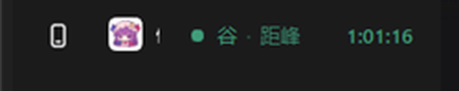
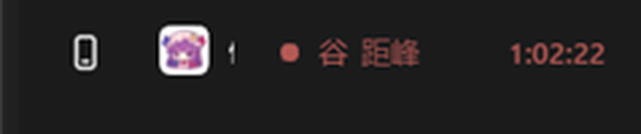
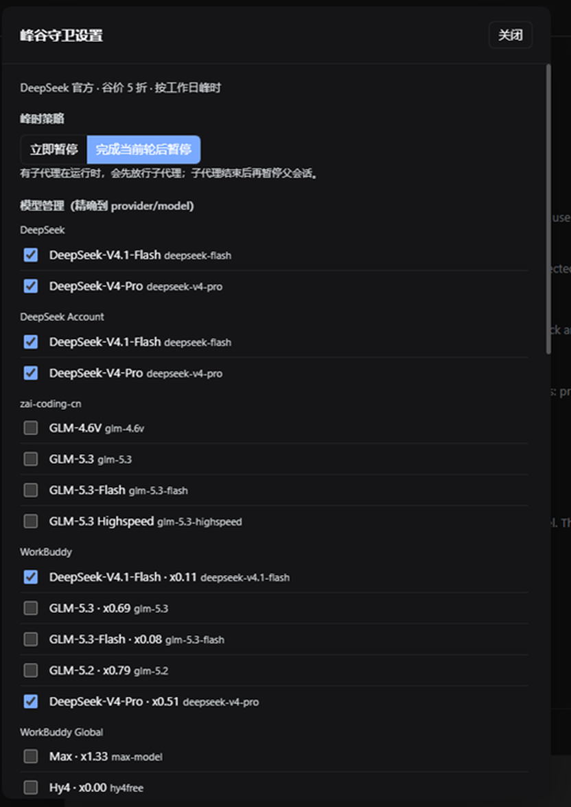

# Off-peak guard (dsh-offpeak-guard)

Published on npm: install it from the DSH Plugins page, or run
`dsh plugin --profile <profile> add dsh-offpeak-guard`.

Schedule work around **DeepSeek peak/off-peak pricing** inside DeepSeek Harness:

- **Time awareness**: per DeepSeek's official pricing, Beijing-time weekdays (excluding Chinese statutory holidays) `09:00–12:00` and `14:00–18:00` are peak; every other hour (weekends, holidays, lunch, night) is off-peak at 50%. Holidays sync from a public API with a built-in 2026 fallback.
- **Model awareness**: exact `provider / model` detection; models containing `deepseek` are managed by default, and the settings panel can toggle each model. `peakPricedModels` / `exemptModels` provide exact control.
- **Peak strategy**: choose immediate pause or finish the current turn first; if a session has running subagents, they are allowed to finish and the parent is paused afterwards, then resumed at off-peak.
- **Peak message holding**: a user message sent during peak is removed from the Agent inbox before it is claimed, stored, and sent with its original content when off-peak starts. Enabled by default; the settings panel can turn it off.
- **Session exemptions**: exempt the current session via `offpeak_guard exempt/unexempt`, or any session from the settings panel / sidebar row; un-exempt at any time. Model tools cannot target other sessions.
- **Tool boundary**: every session-level `offpeak_plan` / `offpeak_guard` action is limited to the calling session; tools cannot deliver prompts to, resume, or wake another session. Cross-session exemptions are a user action in the UI.
- **Work planning**:
  - peak starts → running tasks are paused (the pending inbox is kept, no message is lost);
  - a message sent during peak → held and delivered at off-peak (default);
  - a task already started during peak → stopped immediately, no peak-priced tokens spent;
  - off-peak starts → interrupted tasks are handed back to their session automatically;
  - the `offpeak_plan` tool queues "run this at noon" work for the next off-peak window.
- **UI**: a status strip under the composer (state, countdown, model, paused/held/planned counts), plus a compact clock at the sidebar foot that blinks red before peak starts and green before off-peak starts. Sidebar rows, strip, settings panel, and clock share one status snapshot, so a change in any of them updates the rest. Click the clock to open settings. Hover a session row in the left sidebar for a shield button to exempt/un-exempt it; exempt rows keep a shield marker, and the composer strip has an **Exempt this session** toggle.
- **Theme support**: adapted for `dsh-industrial-acid-skin` (v2.4.x). The clock, composer strip, and settings panel follow the skin's square hard-edge layout, monospace type, and palette; nothing changes when the skin is not installed.

Sidebar clock, colored by the current window:

Red blink within the alert window before peak (sample):

Click the clock to open the settings panel:

## Theme support

Adapted for the **industrial acid skin** (`dsh-industrial-acid-skin`, v2.4.x):

- The skin rebuilds the sidebar footer as square, monospace blocks and places the guard clock and its own AppearanceFooter in the same `sidebar.footer.action` container. The guard now stacks them vertically so the clock takes a full row and the skin controls keep their full width.
- The sidebar clock uses the skin's square border and monospace type, keeps a 32×32 icon in the collapsed rail, and appears with the skin's MORE drawer when the skin collapses the footer — it never covers the session list.
- The settings panel follows the skin's square border, monospace headings, and hard green shadow; segmented buttons, checkboxes, and the session-exemption button use the skin palette.
- The composer strip uses the skin's monospace font. Peak/off-peak colors are derived from the skin palette, so they stay readable in both day and night canvases and after palette changes, instead of hard-coded red/green.
- Everything is scoped under `html[data-industrial-acid]`: with the skin absent, disabled, or after switching back to the default theme, the appearance is unchanged and no configuration is needed.

## Tools

| Tool | Purpose |
| --- | --- |
| `offpeak_status` | Current window, next switch, whether the current model is peak-priced, paused/planned lists |
| `offpeak_plan` | `add` / `list` / `remove` / `clear` off-peak plans |
| `offpeak_guard` | `status` / `pause_now` / `resume_now` / `run_plans_now` manual control (all limited to the current session; global strategy lives in settings) |

## Configuration

The `offpeak-guard` row's `config` in `cordis.patch.yml`, or the plugin settings form in DSH (a Config schema is declared):

| Key | Default | Meaning |
| --- | --- | --- |
| `enabled` | `true` | Master switch |
| `preset` | `auto` | `auto` picks by provider: WorkBuddy/CodeBuddy → `workbuddy`, otherwise `deepseek-official`; can be pinned to `deepseek-official` / `workbuddy` / `custom` |
| `pauseMode` | `pause-now` | `pause-now` pauses immediately; `finish-turn` pauses after the current turn |
| `holdMessages` | `true` | Hold peak-time user messages and send them at off-peak; disable to cancel new turns instead |
| `timezone` | `Asia/Shanghai` | Pricing time zone (DeepSeek bills in Beijing time) |
| `peakWeekdays` | `[1,2,3,4,5]` | Weekdays with peak windows (0 = Sunday); only used by `custom` |
| `peakWindows` | 09:00–12:00, 14:00–18:00 | Peak windows; only used by `custom` |
| `discount` | `0.5` | Off-peak discount, display only; only used by `custom` |
| `holidays` | `[]` | Extra statutory holidays (`YYYY-MM-DD`) appended to synced/built-in dates |
| `holidaySource` | `auto` | `auto` syncs from the public holiday API; `builtin` stays offline |
| `holidayApi` | timor.tech | Dynamic holiday API prefix |
| `modelPattern` | `deepseek` | Fallback match when no exact model list is set |
| `peakPricedModels` | `[]` | Exact peak-priced models (`provider/model` or `model`); takes priority over `modelPattern` |
| `exemptModels` | `[]` | Model ids exempted one by one |
| `pauseRunningOnPeak` | `true` | Pause running tasks when peak starts |
| `deferNewTurnsOnPeak` | `true` | Stop tasks started during peak immediately |
| `resumeOnOffPeak` | `true` | Resume paused tasks when off-peak starts |
| `pollSeconds` | `15` | Check interval (5–300) |
| `resumeDelaySeconds` | `3` | Wait a few seconds after off-peak starts before resuming |
| `bypassMinutes` | `10` | Grace period after a manual resume |
| `alertMinutes` | `10` | Blink the sidebar clock within this many minutes of a switch (0 = never) |

### Environment variables

Deployments can inject settings with environment variables. Priority: **env > config > default**. Invalid values are ignored.

| Variable | Example | Config field |
| --- | --- | --- |
| `DSH_OFFPEAK_ENABLED` | `0` / `1` | `enabled` |
| `DSH_OFFPEAK_PRESET` | `custom` | `preset` |
| `DSH_OFFPEAK_PAUSE_MODE` | `finish-turn` | `pauseMode` |
| `DSH_OFFPEAK_HOLD_MESSAGES` | `0` / `1` | `holdMessages` |
| `DSH_OFFPEAK_TIMEZONE` | `Asia/Shanghai` | `timezone` |
| `DSH_OFFPEAK_PEAK_WEEKDAYS` | `1,2,3,4,5` | `peakWeekdays` |
| `DSH_OFFPEAK_PEAK_WINDOWS` | `09:00-12:00,14:00-18:00` | `peakWindows` |
| `DSH_OFFPEAK_DISCOUNT` | `0.5` | `discount` |
| `DSH_OFFPEAK_HOLIDAYS` | `2026-10-01,2026-10-02` | `holidays` |
| `DSH_OFFPEAK_HOLIDAY_SOURCE` | `builtin` | `holidaySource` |
| `DSH_OFFPEAK_HOLIDAY_API` | `https://.../year` | `holidayApi` |
| `DSH_OFFPEAK_MODEL_PATTERN` | `deepseek` | `modelPattern` |
| `DSH_OFFPEAK_PEAK_MODELS` | `deepseek-flash,vendor/model` | `peakPricedModels` |
| `DSH_OFFPEAK_EXEMPT_MODELS` | `deepseek-v4-pro,deepseek-flash` | `exemptModels` |
| `DSH_OFFPEAK_PAUSE_RUNNING` | `0` / `1` | `pauseRunningOnPeak` |
| `DSH_OFFPEAK_DEFER_NEW` | `0` / `1` | `deferNewTurnsOnPeak` |
| `DSH_OFFPEAK_RESUME` | `0` / `1` | `resumeOnOffPeak` |
| `DSH_OFFPEAK_POLL_SECONDS` | `15` | `pollSeconds` |
| `DSH_OFFPEAK_RESUME_DELAY_SECONDS` | `3` | `resumeDelaySeconds` |
| `DSH_OFFPEAK_BYPASS_MINUTES` | `10` | `bypassMinutes` |
| `DSH_OFFPEAK_ALERT_MINUTES` | `10` | `alertMinutes` |

### Presets

- `deepseek-official` (default): official weekday peak windows plus built-in 2026 Chinese holidays (holidays are off-peak all day).
- `workbuddy`: same peak windows, labeled as WorkBuddy credit pricing; selected automatically for WorkBuddy/CodeBuddy providers.
- `custom`: use `peakWeekdays` / `peakWindows` / `discount` / `holidays` exactly, for other providers or self-hosted pricing.

## Settings panel

Click the sidebar clock to open it:

- **Peak strategy**: pause immediately or finish the current turn first;
- **Message holding**: hold messages sent during peak and send them at off-peak;
- **Models**: provider-grouped catalog with a checkbox per model (persisted as `modelRules`, overriding `modelPattern`);
- **Session exemptions**: searchable list of live root sessions; hover a session row in the left sidebar for a shield button, or use the **Exempt this session** button in the composer strip to toggle the current conversation directly;
- **Holidays**: show the dynamic sync state.

### Route admission

The settings route `/plugins/dsh-offpeak-guard/action` goes through host authentication:

- the route is only registered once both `webServer` and `connection` are available;
- every request passes `connection.requestRejection(req)` first — its Host/Origin fence stops DNS rebinding and cross-site calls, and its browser authentication stops pages that never logged in; a 401/403 is answered before any business logic runs;
- a missing `connection`, or one that throws, rejects the request (fail closed); there is no fallback to checking only Host, Origin or the loopback address;
- request bodies are capped at 64 KiB and answer 413 above that.

## Subagents and waiting

- Running subagents are allowed to finish; the parent is paused after the last child ends and resumed off-peak;
- In `finish-turn` mode the current turn finishes; a queued next turn is stopped and recorded;
- A finished turn is marked `completed`, so no spurious turn is started at off-peak.

## Data

State and snapshots live in `$DSH_HOME/offpeak-guard/`:

- `state.json`: paused/waiting tasks, held peak messages, plans, session exemptions, exact model rules, peak strategy;
- `status.json`: read-only snapshot for the UI (mirrored to `~/.dsh/offpeak-guard/status.json`);
- `holidays.json`: cached dynamic holiday dates.

Nothing is written into user workspaces.

## Holding peak messages

- When a user sends a message during peak, the Host first inserts it into the Agent inbox. The guard listens to `agent/inbox/inserted` and removes it before the Agent claims it, then stores it in `state.json` under `heldMessages`.
- At off-peak, the tick sends the original `content` again, preserving text and attachment blocks; the composer strip shows "held N".
- The settings panel toggle "Hold messages sent during peak" turns this off; the old immediate-cancel behavior returns.
- If persisting the hold fails, the message is put back into the inbox so it is not lost.
- This is host-side behavior and does not modify the composer DOM; commands and attachments still use the normal DSH composer.

## Tool session boundaries

- `offpeak_plan` can only add/list/remove/clear plans for the session that calls it; any other `sessionId` is rejected.
- `offpeak_guard`'s `pause_now`, `resume_now`, `run_plans_now`, `exempt`, and `unexempt` only act on the calling session; omitting `sessionId` never falls back to "all sessions". `status` returns only the current session's details, and `pause_mode` can only be changed by the user in the settings panel.
- Automatic peak pause/resume is unchanged: the guard still handles every root session by rule.
- Legacy plans without `createdBySessionId` have no provable authorization source; they are marked failed and skipped, and must be re-created from the target session.
- Cross-session exemptions are a user action in the settings panel or the sidebar row; model tools provide no cross-session delivery.

## How resuming works

Pause uses `sessionController.cancel`, which ends only the current turn and keeps the pending inbox. Resume uses `sessionController.prompt` to deliver a "continue where you left off" instruction to the original session; cold sessions are woken automatically. The resume text mentions the interruption time and the paused model so it stays traceable in the conversation.

## Boundaries

- Dynamic holidays come from a third-party public API (default timor.tech; only the year is sent). Offline failures fall back to the `holidays.json` cache and the built-in 2026 list; set `holidaySource: builtin` for fully offline operation.
- Built-in statutory holidays cover 2026 only; the dynamic sync fills later years once published, or append dates with `holidays`.
- Named presets have fixed windows; use `preset: custom` for other providers or self-hosted pricing.
- Only root sessions with a working directory are handled; subagent sessions are skipped so parents do not hang.
- Subagent results are consumed by the parent after it resumes; the guard stops the parent at child completion but cannot intercept messages already written into the parent history.
- A session exemption affects future pauses/resumes only; use `resume_now` in the current session to resume an already paused task.
- A plugin restart does not cancel tasks that are already running (so installing the plugin cannot kill the current conversation); the next peak or new task follows the rules again.
- Manual `resume_now` grants the current session a 10-minute grace period so it is not paused again immediately.
