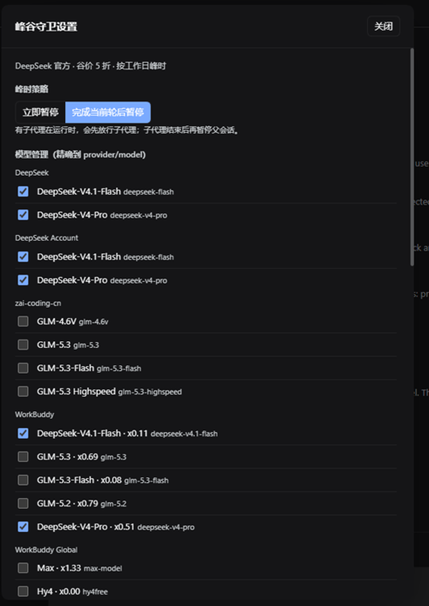

# 错峰调度 · 峰谷守卫（dsh-offpeak-guard）

已发布到 npm：在 DSH 的插件页搜索 `dsh-offpeak-guard` 安装，或运行
`dsh plugin --profile <profile> add dsh-offpeak-guard`。

在 DeepSeek Harness 里按 **DeepSeek 峰谷计价** 安排工作：

- **时间识别**：按 DeepSeek 官方规则，北京时间周一至周五（不含中国法定节假日）`09:00–12:00`、`14:00–18:00` 为峰值原价；其余时间（含周末、法定节假日全天）为谷价，按 5 折计费。节假日默认从公开 API 动态同步，失败时回退内置 2026 列表。
- **模型识别**：按会话真实 `provider / model` 精确判断；默认名字含 `deepseek` 的模型受管理，可在设置面板逐模型开关，或用 `peakPricedModels` / `exemptModels` 精确控制。
- **峰时策略**：可选「立即暂停」或「完成当前轮后暂停」；会话有子代理在跑时先放行子代理，子代理结束后再暂停父会话，谷价开始时恢复。
- **会话豁免**：可让某个会话不参与插件的暂停/恢复（设置面板或 `offpeak_guard exempt/unexempt`），随时取消豁免。
- **工作规划**：
  - 峰时开始 → 暂停正在运行的任务（保留待处理队列，不丢消息）；
  - 峰时新起的任务 → 立即停住，不花峰时 token；
  - 谷价开始 → 自动把被打断的任务交还会话继续执行；
  - 另提供 `offpeak_plan` 工具，把「12 点再跑」这类事排进下一个谷价窗口。
- **界面**：输入框下方一条状态条，显示当前峰/谷、距下次切换的倒计时、当前模型，以及暂停/规划数量；左侧栏底部另有一枚常驻计时，临近切换时闪色提醒（峰价快开始闪红、谷价快开始闪绿）。**点击左栏计时打开设置面板**：切换峰时策略、逐模型管理、会话豁免、查看节假日同步状态。

左栏计时（平时按峰/谷着色）：

距峰价开始 10 分钟内闪红（示例）：

点击左栏计时打开设置面板：

## 工具

| 工具 | 用途 |
| --- | --- |
| `offpeak_status` | 当前时段、下次切换、当前模型是否适用、暂停与规划清单 |
| `offpeak_plan` | `add` / `list` / `remove` / `clear` 错峰规划 |
| `offpeak_guard` | `status` / `pause_now` / `resume_now` / `run_plans_now` 手动控制 |

## 配置

`cordis.patch.yml` 里那一行 `offpeak-guard` 的 `config`，或在 DSH 设置页的插件配置里修改（已声明 Config schema）：

| 键 | 默认 | 说明 |
| --- | --- | --- |
| `enabled` | `true` | 总开关 |
| `preset` | `auto` | `auto` 按 provider 自动选：WorkBuddy/CodeBuddy → `workbuddy`，其余 → `deepseek-official`；也可固定为 `deepseek-official` / `workbuddy` / `custom` |
| `pauseMode` | `pause-now` | `pause-now` 峰时立即暂停；`finish-turn` 当前轮跑完后再暂停 |
| `timezone` | `Asia/Shanghai` | 计价时区（DeepSeek 计费按北京时间） |
| `peakWeekdays` | `[1,2,3,4,5]` | 峰时适用的星期（0=周日）；仅 `custom` 预设使用 |
| `peakWindows` | 09:00–12:00、14:00–18:00 | 峰时窗口；仅 `custom` 预设使用，官方调价时改这里 |
| `discount` | `0.5` | 谷价折扣，仅用于显示「5 折」；仅 `custom` 预设使用 |
| `holidays` | `[]` | 追加的法定节假日（`YYYY-MM-DD`），在动态/内置列表上追加 |
| `holidaySource` | `auto` | `auto` 从公开节假日 API 动态同步；`builtin` 只用内置/配置列表 |
| `holidayApi` | timor.tech | 动态节假日 API 前缀 |
| `modelPattern` | `deepseek` | 未配置精确列表时，模型名/供应商名包含它即视为峰谷计价模型 |
| `peakPricedModels` | `[]` | 精确的峰谷计价模型列表（`provider/model` 或 `model`）；非空时优先于 `modelPattern` |
| `exemptModels` | `[]` | 逐项豁免的模型 id |
| `pauseRunningOnPeak` | `true` | 峰时开始时暂停正在运行的任务 |
| `deferNewTurnsOnPeak` | `true` | 峰时新起的任务立即停住 |
| `resumeOnOffPeak` | `true` | 谷价开始时自动恢复 |
| `pollSeconds` | `15` | 检查间隔（5–300） |
| `resumeDelaySeconds` | `3` | 谷价开始后等几秒再恢复 |
| `bypassMinutes` | `10` | 手动恢复后的豁免期，避免立刻又被暂停 |
| `alertMinutes` | `10` | 左栏计时在距切换多少分钟内开始闪烁（0 = 不闪） |

### 环境变量

部署方可以用环境变量统一注入，优先级：**环境变量 > 配置 > 默认**。无效值会被忽略。

| 环境变量 | 例子 | 对应配置 |
| --- | --- | --- |
| `DSH_OFFPEAK_ENABLED` | `0` / `1` | `enabled` |
| `DSH_OFFPEAK_PRESET` | `custom` | `preset` |
| `DSH_OFFPEAK_PAUSE_MODE` | `finish-turn` | `pauseMode` |
| `DSH_OFFPEAK_TIMEZONE` | `Asia/Shanghai` | `timezone` |
| `DSH_OFFPEAK_PEAK_WEEKDAYS` | `1,2,3,4,5` | `peakWeekdays` |
| `DSH_OFFPEAK_PEAK_WINDOWS` | `09:00-12:00,14:00-18:00` | `peakWindows` |
| `DSH_OFFPEAK_DISCOUNT` | `0.5` | `discount` |
| `DSH_OFFPEAK_HOLIDAYS` | `2026-10-01,2026-10-02` | `holidays` |
| `DSH_OFFPEAK_HOLIDAY_SOURCE` | `builtin` | `holidaySource` |
| `DSH_OFFPEAK_HOLIDAY_API` | `https://.../year` | `holidayApi` |
| `DSH_OFFPEAK_MODEL_PATTERN` | `deepseek` | `modelPattern` |
| `DSH_OFFPEAK_PEAK_MODELS` | `deepseek-flash,vendor/model` | `peakPricedModels` |
| `DSH_OFFPEAK_EXEMPT_MODELS` | `deepseek-v4-pro,deepseek-flash` | `exemptModels` |
| `DSH_OFFPEAK_PAUSE_RUNNING` | `0` / `1` | `pauseRunningOnPeak` |
| `DSH_OFFPEAK_DEFER_NEW` | `0` / `1` | `deferNewTurnsOnPeak` |
| `DSH_OFFPEAK_RESUME` | `0` / `1` | `resumeOnOffPeak` |
| `DSH_OFFPEAK_POLL_SECONDS` | `15` | `pollSeconds` |
| `DSH_OFFPEAK_RESUME_DELAY_SECONDS` | `3` | `resumeDelaySeconds` |
| `DSH_OFFPEAK_BYPASS_MINUTES` | `10` | `bypassMinutes` |
| `DSH_OFFPEAK_ALERT_MINUTES` | `10` | `alertMinutes` |

### 预设

- `deepseek-official`（默认）：官方工作日峰时 + 内置 2026 法定节假日（节假日全天谷价）。
- `workbuddy`：WorkBuddy 积分规则，峰时窗口与官方相同；按 provider 自动选择时用于标注来源。
- `custom`：完全使用 `peakWeekdays` / `peakWindows` / `discount` / `holidays`，适合其他供应商或自建计价。

## 设置面板

点击左栏计时打开：

- **峰时策略**：立即暂停 / 完成当前轮后暂停；
- **模型管理**：按 provider 分组列出模型目录，勾选即精确纳入峰谷管理（写入 `state.json` 的 `modelRules`，优先于 `modelPattern`）；
- **会话豁免**：勾选某个会话后，它不再被暂停/恢复；取消勾选立即恢复管理；
- **节假日**：显示动态同步状态。

面板里的修改立即生效并持久化。

## 子代理与等待

- 峰时开始时若会话有**正在运行的子代理**，先放行父会话与子代理；
- 子代理结束后，父会话按当前策略暂停（`waiting-children`），谷价开始后自动恢复；
- 「完成当前轮后暂停」模式下，当前轮允许跑完；如果随后又排入了下一轮，下一轮会在峰时被拦下并记录，谷价开始恢复；
- 当前轮跑完且没有后续轮次时，记录标记为 `completed`，不会在谷价时无意义地再起一轮。

## 数据

状态与快照都在 `$DSH_HOME/offpeak-guard/`：

- `state.json`：暂停/等待中的任务、错峰规划、会话豁免、精确模型规则、峰时策略；
- `status.json`：给输入框状态条/设置面板读的只读快照（同时镜像到 `~/.dsh/offpeak-guard/status.json`）；
- `holidays.json`：动态同步的节假日缓存。

不写用户工作区。

## 恢复是怎么做的

暂停用 `sessionController.cancel`，它只结束当前一轮、保留待处理队列；恢复用 `sessionController.prompt` 向原会话投递一条「继续上次中断处」的指令，冷会话会被自动唤醒。恢复文本会注明中断时间与被暂停的模型，方便对话里追溯。

## 边界

- 动态节假日来自第三方公开 API（默认 timor.tech，只发送年份）；离线或接口失败时回退 `holidays.json` 缓存与内置 2026 列表。可设 `holidaySource: builtin` 完全离线。
- 内置法定节假日目前覆盖 2026 年；2027 年安排公布后动态同步会自动补，或用 `holidays` / `DSH_OFFPEAK_HOLIDAYS` 追加，否则节假日会被当作普通工作日。
- 命名预设的窗口是固定的；需要其他供应商/自建计价时用 `preset: custom` 配 `peakWindows`。
- 只处理有工作目录、非子代理的根会话，避免打断子代理让父会话卡住。
- 子代理结果在父会话恢复后由模型继续消费；插件能在子代理结束时停住父会话，但无法在传输层拦截已经进入父会话历史的消息。
- 「会话豁免」只影响后续暂停/恢复，不会自动把已经暂停的任务立即恢复；需要时用 `resume_now`。
- 插件自身重启时不会主动打断正在跑的任务（避免刚安装就停掉当前对话）；之后进入峰时或新起任务仍按规则处理。
- 手动「立即恢复」会给这些会话 10 分钟豁免，避免峰时刚恢复又被停回去。
